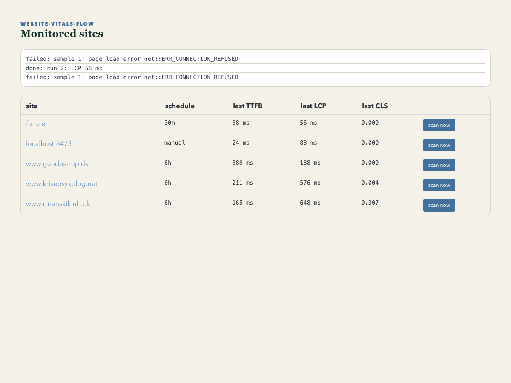
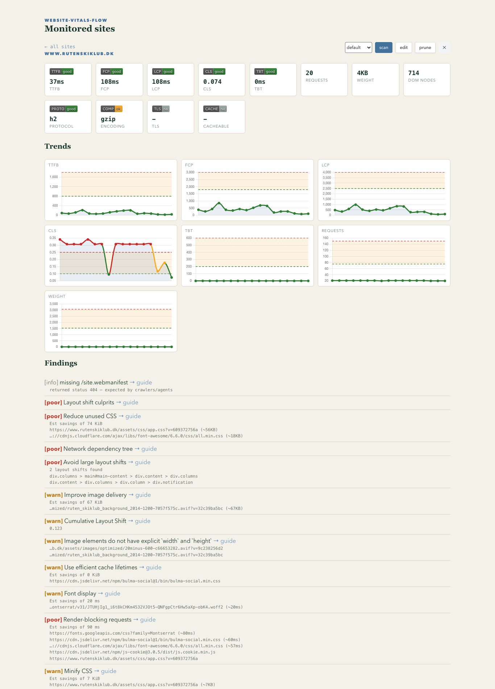

# website-vitals-flow

Contained web-performance monitor for localhost and deployed sites —
Core Web Vitals + HTTP behaviour (h2/h3, compression, caching) via a
real Chrome, plus optional deep layers (web-vitals.js attribution,
Lighthouse audits, PSI). Single Go binary, SQLite state.

## Quick start

    go build -o bin/wvf ./cmd/wvf
    ./bin/wvf scan http://localhost:3000        # one-shot, saved under site key
    ./bin/wvf scan <url> --deep                 # + attribution + lighthouse
    ./bin/wvf scan <url> --psi                  # + PageSpeed Insights (FQDN only)
    ./bin/wvf sites add http://localhost:3000 --schedule 30m
    ./bin/wvf serve                             # dashboard + scheduler (127.0.0.1:8420)
    ./bin/wvf doctor                            # engine availability

## Dashboard

Site detail — trend chart, findings, run history (deeplink `?site=<key>` or `#<key>`):

## API (IDE/agent-callable)

Full reference: [docs/api.md](docs/api.md) — REST endpoints, VS Code
tasks.json setup, and `wvf mcp`: an MCP stdio server exposing
scan/history/run/prune as native agent tools.

    POST /api/scan      {"url": "...", "wait": 90, "deep": true}  # sync or async
    GET  /api/jobs/{id}                              # poll → run_id
    GET  /api/sites/{key}/runs                       # history
    POST /api/scan-now  {"key": "..."}               # by site key

## Commands

`scan <url>` [--samples N] [--settle D] [--timeout D] [--json] [--html f] [--deep] [--psi] [--only lcp,cls,...]
`sites add|list|remove` [--schedule D] [--deep] [--only set] · `report <id>` · `prune`
`compare <site>` [--base <run-id>] [--thresh %] — baseline-vs-latest metric diff
`serve` · `doctor` · `mcp` (stdio MCP server for IDEs/agents)

### Badges & screenshots

- `GET /badges/{metric}-{band}.svg` — vendored shields.io badges
  (badge-maker, generated offline via `npm run gen:badges`)
- `GET /badge.svg?metric=lcp&value=648` or `?run=<id>&metric=cls` —
  value-bearing badges, band-colored
- `go run ./scripts/shot <url> <out.png> [wait-ms] ['js'] [height]` —
  regenerate docs/screenshots headlessly

## Inspiration

wvf takes heavy inspiration from [webvitals.dev](https://webvitals.dev/)
(CWV debugging tooling — LCP/CLS/INP attribution, threshold bands) and
[sitespeed.io](https://sitespeed.io) (repeatable median-of-N scanning,
coach-style findings, trend history), and from
[Lighthouse](https://github.com/googlechrome/lighthouse)/PSI for audits
and field data. Unlike sitespeed's Grafana/Graphite stack, wvf is a
**minimal self-hosted single binary** for local and dev-loop testing:
SQLite state, embedded dashboard, serialized scan queue, zero daemons.

## Resources & packages

Measurement: [chromedp](https://github.com/chromedp/chromedp) (CDP),
[web-vitals](https://github.com/GoogleChrome/web-vitals) 6.2.3 vendored,
[Lighthouse](https://github.com/googlechrome/lighthouse) (optional),
[PSI API](https://developers.google.com/speed/docs/insights/v5/about),
[quic-go](https://github.com/quic-go/quic-go) (h3 probe),
[cachecontrol](https://github.com/pquerna/cachecontrol) (RFC 7234).
Infra: [cobra](https://github.com/spf13/cobra),
[modernc sqlite](https://pkg.go.dev/modernc.org/sqlite) (pure-Go).
UI: [Bulma](https://bulma.io), [Alpine CSP](https://alpinejs.dev),
[Chart.js](https://www.chartjs.org), [shields.io](https://shields.io)/
[badge-maker](https://www.npmjs.com/package/badge-maker) — all vendored,
no CDN/runtime deps. References:
[web.dev vitals](https://web.dev/articles/vitals),
[Lighthouse scoring](https://developer.chrome.com/docs/lighthouse/performance/performance-scoring),
[Chrome performance insights](https://developer.chrome.com/docs/performance/insights),
[WebPageTest](https://github.com/catchpoint/WebPageTest) (prior art).

## Config (wvf.yml / WVF_* env)

`samples` 3 · `settle` 1.5s · `scan_timeout` 90s · `keep_last` 100 ·
`max_age_days` 56 · `listen` 127.0.0.1:8420 · `state_db` state.db ·
`browser_path` auto-detect · `psi_key`/`WVF_PSI_KEY` for PSI (unauthenticated
quota is ~0 — a key is required in practice)

## Design

- Engine tag per run (cdp|lighthouse|psi) — trend charts stay single-source
- Retention pruned inside the run-insert transaction
- Single-slot scan queue — all triggers (cli/manual/scheduled) share one path
- Lighthouse/node optional: `doctor` reports, scans degrade to CDP-only
- Field data (PSI) is opt-in via --psi, public FQDNs only, stored in the
  same detail_json but clearly separate from lab metrics
- `sites add --deep` makes scheduled + scan-now runs deep per-site;
  jobs carry a deep flag so one-off deep scans don't change the site
